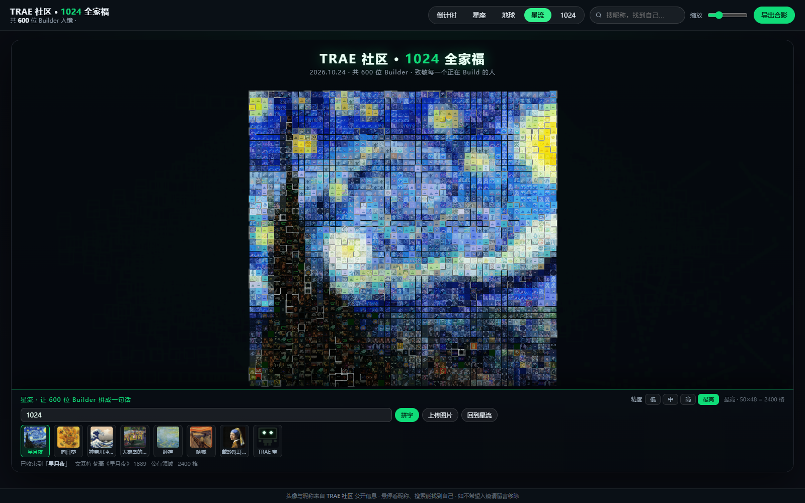
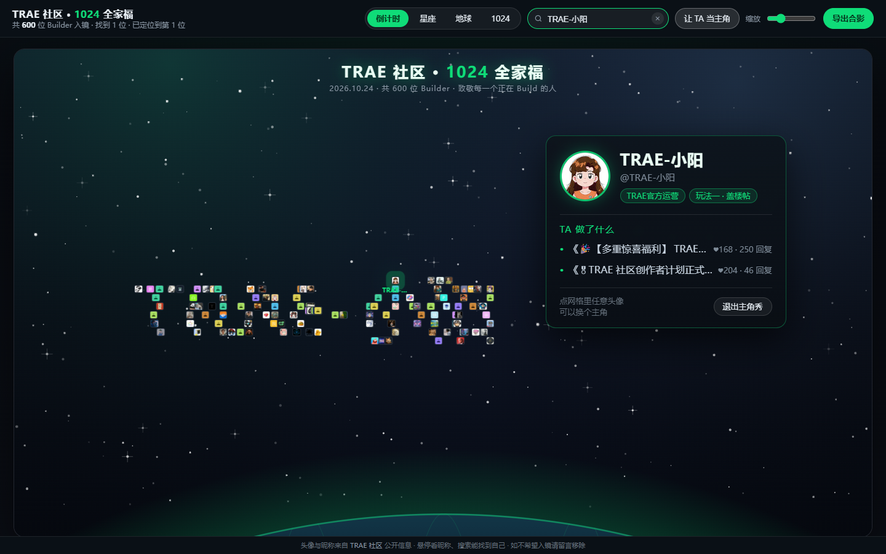
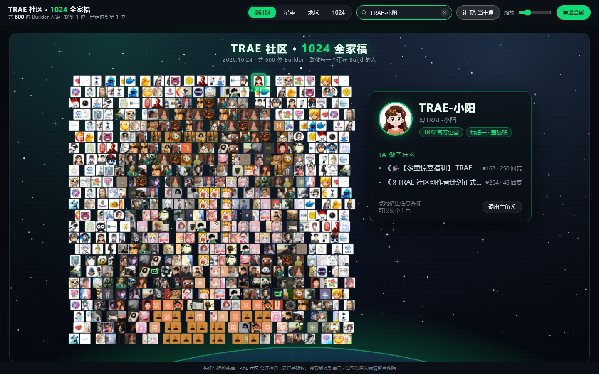
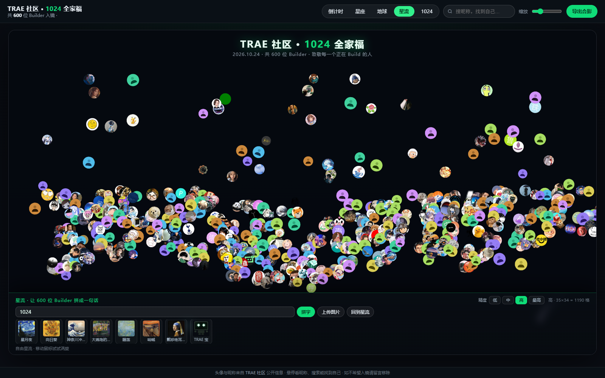
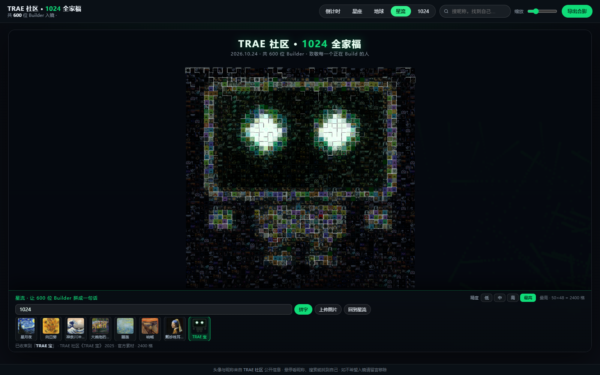

# TRAE 社区 1024 全家福

> 600 位 Builder 的头像，一场可以玩的社区合影。

**在线体验**：https://xcsweb.github.io/trae-1024-family-photo/

纯前端、零依赖、单文件。打开即是 600 位社区成员的头像拼成的倒计时，可以切换星座、地球、星流、1024 五种形态。



## 五种形态

| 形态 | 说明 |
| --- | --- |
| 倒计时 | 600 个头像实时拼出距 1024 的剩余时间；最后一天带秒 |
| 星座 | 头像散在夜空，近邻之间自动连线（791 条），像一片社区星图 |
| 地球 | Fibonacci 球面均匀铺点，可拖拽旋转、松手自转 |
| 星流 | 头像随 curl-noise 流场漂移，鼠标划过形成涡旋；可收束成文字、上传图片或名画 |
| 1024 | 所有人归位拼成巨大的「1024」点阵 |

## 主角秀

倒计时每 8 秒自动切一次主角秀：先用 600 张头像拼出主角的**昵称**，再重排拼出他的**头像**。每格都选主色调最接近的那位成员，颜色稀缺时同一人可以复用多格——是真正的像素画，不是滤镜。




## 星流

600 张头像先散成一片流动的星尘，点一下收束成一幅画：

- **文字**：任意 1–12 个字符，默认「1024」
- **上传图片**：任意 JPG/PNG，按 cover 裁切后做像素马赛克
- **名画预设**：梵高《星月夜》《向日葵》、葛饰北斋《神奈川冲浪里》、修拉《大碗岛的星期天下午》、莫奈《睡莲》、蒙克《呐喊》、维米尔《戴珍珠耳环的少女》，以及官方 IP「TRAE 宝」

精度四档：20×19 / 25×24 / 35×34 / 50×48。格数超过 600 时同一成员可占多格。




## 实现

三层叠加渲染，不引入任何第三方库：

- **Canvas 2D**：星野背景、轨迹与点彩拖尾
- **SVG**：星座模式的 791 条连线
- **DOM + transform**：600 个头像的布局与过渡；帧率不足时自动切到画布渲染

排布算法：

- 倒计时 / 1024 / 文字：文字栅格化到离屏 Canvas，二分搜索刚好容纳目标点数的格子尺寸
- 星座：聚类中心 + 螺旋散点，再对每个点连最近的两个同伴
- 地球：Fibonacci 球面 + 正交投影，按深度排序控制遮挡与近大远小
- 星流：自写 2D 值噪声 → curl 向量场；收束时用「色差 + 亮度差 + 复用惩罚」做最近色匹配
- 导出：按当前布局用 Canvas 重绘 2 倍分辨率 PNG

## 目录

```
index.html              打包后的单文件作品（GitHub Pages 直接托管）
src/index.html          源码（data.js 未内联）
src/data.js             600 位成员的公开数据（头像 / 昵称 / 发帖数 / 近期主题）
src/build-single.mjs    打包脚本：把 data.js 内联进单文件
src/fetch.mjs           论坛公开接口抓取脚本
src/presets-data.js     8 幅预设的 150×144 PNG data URL
docs/                   投稿文案与社区数据分析
screenshots/            截图
tools/                  社区监控脚本
```

## 本地运行

直接双击 `index.html`，或起一个静态服务：

```bash
npx serve .
```

改源码后重新打包：

```bash
cd src
node build-single.mjs
```

## 数据与版权

- 600 位成员的头像与昵称均来自 TRAE 社区公开信息，仅作 1024 节日纪念用途，不作商业使用；如不希望入镜，提 issue 即可移除。
- 星流名画预设均为公有领域作品；「TRAE 宝」为 TRAE 官方 IP，按官方形象绘制。
- 所有预设以 data URL 内嵌，不请求任何外部资源，断网可用。
